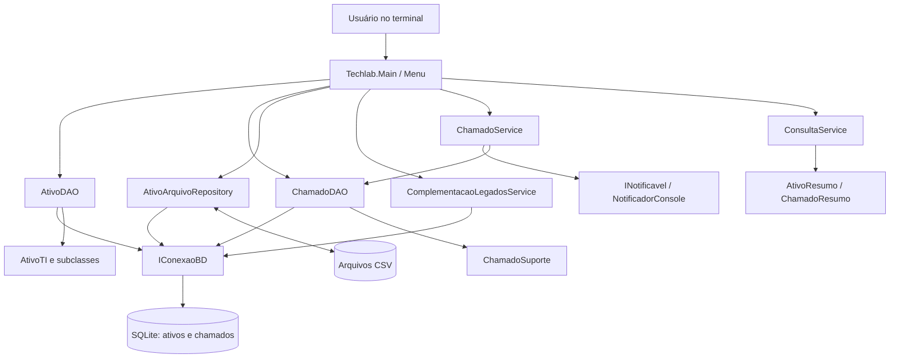
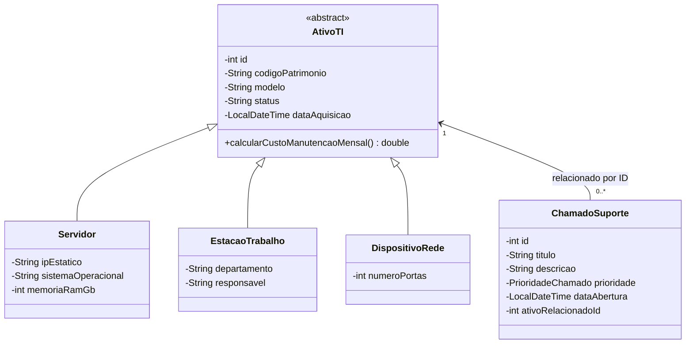

# TechLab Inventory & Service Desk

Sistema de linha de comando, desenvolvido em **Java 21**, para gerenciar equipamentos de tecnologia da informação e chamados de suporte. O projeto integra conceitos de **Programação Orientada a Objetos (POO)**, persistência em **SQLite** e arquivos **CSV**, com organização por responsabilidades, tratamento de exceções e testes automatizados.

> **Situação:** versão em preparação para a entrega final da disciplina de Programação Orientada a Objetos e Persistência. A implementação consolidada está na branch `feat/integracao-professor`. **A branch `main` ainda precisa receber essa versão antes da entrega**, e a tag `v1.0-final` ainda não foi criada.

## Funcionalidades

- Cadastro de equipamentos nas categorias **Servidor**, **EstacaoTrabalho** e **DispositivoRede**.
- Consulta, listagem, atualização e exclusão de equipamentos.
- Abertura, consulta, listagem, atualização e exclusão de chamados vinculados a equipamentos.
- Prioridades de chamados: `BAIXA`, `MEDIA`, `ALTA` e `CRITICA`.
- Bloqueio da exclusão de equipamentos que possuem chamados associados.
- Exportação e importação de equipamentos em CSV, com validação de campos, prevenção de duplicidades por patrimônio e transação para importação.
- Complementação assistida de campos ausentes em cadastros legados, mantendo os IDs e os valores já preenchidos.
- Criação automática das tabelas SQLite ao iniciar a aplicação pela primeira vez.
- Testes automatizados com JUnit 5.
- Filtros e ordenação em memória com coleções genéricas e Streams (equipamentos e chamados).
- Notificações exibidas no terminal na abertura e atualização de chamados, usando o contrato `INotificavel` (não há envio de e-mail ou SMS).

## Tecnologias

| Tecnologia | Utilização |
| --- | --- |
| Java 21 | Linguagem principal |
| Apache Maven 3.x | Compilação e dependências |
| SQLite | Banco relacional local |
| SQLite JDBC (`org.xerial:sqlite-jdbc`) | Comunicação com SQLite via JDBC |
| JUnit Jupiter 5 | Testes automatizados |
| Git e GitHub | Versionamento e entrega |

## Pré-requisitos

- **JDK 21** instalado e disponível no terminal (`java -version`).
- **Maven 3.x** instalado e disponível no terminal (`mvn -version`).
- **Git** para clonar o repositório.
- Conexão à internet na primeira compilação, para obter as dependências do Maven Central.

## Como executar

A partir do terminal (PowerShell, bash ou terminal do VS Code):

```bash
git clone --branch feat/integracao-professor https://github.com/Rafaelamoury/TechLabInventory.git
cd TechLabInventory
mvn clean package
mvn exec:java
```

Na primeira execução, a aplicação cria automaticamente o arquivo `dados/techlab-inventory.db`, com as tabelas necessárias. **Não é preciso criar um banco ou executar scripts SQL manualmente.**

O menu principal apresenta as seguintes operações:

| Opção | Ação |
| ---: | --- |
| 1 | Listar equipamentos |
| 2 | Cadastrar equipamento |
| 3 | Consultar equipamento por ID |
| 4 | Atualizar equipamento |
| 5 | Excluir equipamento |
| 6 | Listar chamados |
| 7 | Abrir chamado |
| 8 | Consultar chamado por ID |
| 9 | Atualizar chamado |
| 10 | Excluir chamado |
| 11 | Exportar equipamentos para CSV |
| 12 | Importar equipamentos novos de CSV |
| 13 | Completar cadastro antigo de equipamento |
| 14 | Completar cadastro antigo de chamado |
| 15 | Filtrar equipamentos e ordenar por patrimônio |
| 16 | Filtrar chamados e ordenar por descrição |
| 0 | Sair |

Para encerrar a aplicação normalmente, selecione `0` no menu.

## Como executar os testes

```bash
mvn clean test
```

Na validação de **18/11/2026**, a suíte executou **21 testes JUnit 5**, com **0 falhas, 0 erros e 0 testes ignorados**. A cobertura inclui modelagem e validação do domínio, DAOs, conexão SQLite, persistência CSV, filtros e notificações. Os testes de integração com o banco utilizam arquivos SQLite temporários; **não utilizam o banco local `dados/techlab-inventory.db`**.

Para compilar, testar e empacotar:

```bash
mvn clean package
```

O artefato é gerado em `target/techlab-inventory-1.0.0-SNAPSHOT.jar`. **Esse JAR não inclui todas as dependências externas**; a forma recomendada de execução neste projeto é `mvn exec:java`.

## Arquitetura e organização

```text
TechLabInventory/
├── pom.xml
├── README.md
├── .gitignore
├── src/
│   ├── Techlab/
│   │   ├── Main.java                  # Menu e interação pelo terminal
│   │   ├── negocio/                  # Entidades, herança e enum de prioridades
│   │   ├── interfaces/               # Contratos de conexão, persistência e notificação
│   │   ├── dao/                      # Persistência SQLite de ativos e chamados
│   │   ├── db/                       # Conexão, inicialização e migrações
│   │   ├── dto/                      # Representação de registros CSV
│   │   ├── repository/               # Importação e exportação em CSV
│   │   ├── exceptions/               # Exceções específicas
│   │   └── service/                  # Consultas, notificações e complementação de cadastros antigos
│   └── test/java/Techlab/           # Testes JUnit e suporte a bancos temporários
├── dados/                           # Gerado localmente; ignorado pelo Git
└── target/                          # Gerado pelo Maven; ignorado pelo Git
```

### Visão de componentes



### Modelo de domínio



### Abstrações de software

- `IPersistencia<T>` define as operações de CRUD; `AtivoDAO` e `ChamadoDAO` implementam esse contrato.
- `IConexaoBD` define o acesso à conexão JDBC e a inicialização do banco; `ConexaoBanco` implementa esse contrato.
- `INotificavel` é implementada por `NotificadorConsole` e utilizada por `ChamadoService` para emitir avisos no terminal após salvar ou atualizar chamados.
- `ConsultaService` filtra e ordena `List<AtivoResumo>` e `List<ChamadoResumo>` com Streams e `Comparator`, considerando registros legados incompletos sem inventar informações. As buscas desconsideram maiúsculas/minúsculas.
- Os DAOs utilizam `PreparedStatement` para parametrizar os dados das consultas e alterações SQL.

## Persistência e integridade dos dados

O SQLite mantém duas tabelas principais:

- **`ativos`**: patrimônio único, modelo, categoria, status, data de aquisição e campos específicos da categoria.
- **`chamados`**: título, descrição, prioridade, data de abertura e `ativo_id` como chave estrangeira para `ativos.id`.

A aplicação habilita as restrições de chaves estrangeiras por conexão e impede a exclusão de um equipamento com chamados associados. A inicialização verifica a estrutura e a integridade do banco.

**Segurança dos dados locais:** o banco de execução padrão fica em `dados/techlab-inventory.db`, não é versionado e permanece separado do banco legado `techlab.db`. A aplicação bloqueia a abertura direta do banco legado `techlab.db` por meio da configuração de conexão. O caminho de teste `techlab-fase2-teste.db` é aceito somente quando esse arquivo já existe; no uso normal, execute sem argumentos para abrir o banco isolado `dados/techlab-inventory.db`.

## CSV: importação e exportação

Na opção **11**, o programa exporta os registros de equipamentos para `../TechLabCSV-exportacoes/ativos-<timestamp>.csv` (**um nível acima da pasta do projeto**). A pasta de destino deve permitir gravação no computador utilizado.

Na opção **12**, o usuário informa o caminho de um arquivo CSV compatível e precisa confirmar a operação digitando `IMPORTAR`. A importação adiciona apenas patrimônios inexistentes; os IDs do arquivo não são reutilizados. A inserção ocorre em uma transação para evitar importações parcialmente gravadas em caso de falha.

O formato de CSV usa codificação UTF-8, separador `;` e cabeçalho validado. Os campos com `;` ou aspas recebem tratamento de escape.

## Tratamento de erros

O projeto possui exceções específicas, incluindo:

- `EquipamentoNaoEncontradoException`
- `ChamadoNaoEncontradoException`
- `EquipamentoComChamadosException`
- `FalhaConexaoBDException`

Além das exceções específicas, entradas inválidas são tratadas e exibidas no terminal sem encerrar toda a aplicação, quando possível.

## Referências e créditos

Projeto desenvolvido no contexto da disciplina **Programação Orientada a Objetos e Persistência**, com base no enunciado **TechLab Inventory & Service Desk** e na implementação parcial disponibilizada pelo professor. A solução atual amplia a modelagem de domínio, as operações CRUD, a persistência, a interface de terminal, os testes e a documentação.

- [Repositório deste projeto](https://github.com/Rafaelamoury/TechLabInventory)
- [Repositório-base da disciplina](https://github.com/tbezerrasoares/POO_e_Persistencia_2026.2)

## Correspondência com o enunciado da disciplina

| Entrega prevista no enunciado | Implementação no TechLab |
| --- | --- |
| Classe abstrata `AtivoTI`, encapsulamento e validação | `negocio/AtivoTI.java` e subclasses |
| Herança: `Servidor`, `EstacaoTrabalho`, `DispositivoRede` | `negocio/` |
| Entidade `ChamadoSuporte` vinculada a um ativo | `negocio/ChamadoSuporte.java` e chave estrangeira `chamados.ativo_id` |
| Contratos `IConexaoBD`, `INotificavel`, `IPersistencia` | `interfaces/` e implementações em `db/`, `service/` e `dao/` |
| Exceções personalizadas | `exceptions/` |
| Coleções, DTOs, filtragem e ordenação | `dao/*Resumo.java` e `service/ConsultaService.java` |
| Arquivo CSV e banco relacional | `repository/AtivoArquivoRepository.java` e SQLite |
| CRUD e proteção contra SQL Injection | `dao/AtivoDAO.java`, `dao/ChamadoDAO.java` e `PreparedStatement` |
| Histórico Git, documentação, diagramas e tag final | Commits e README presentes; tag `v1.0-final` pendente |

## Roteiro rápido de demonstração

1. Execute `mvn clean test` e observe o resumo da suíte JUnit.
2. Execute `mvn exec:java`; na primeira execução, o banco é criado automaticamente.
3. Cadastre um equipamento com a opção **2** e consulte-o com as opções **1** e **3**.
4. Abra um chamado para esse equipamento com a opção **7** e consulte-o com a opção **8**.
5. Atualize o equipamento (**4**) e o chamado (**9**) e confira a persistência após reiniciar a aplicação.
6. Mostre os filtros das opções **15** e **16** e a notificação ao atualizar um chamado.
7. Apresente as opções **11** e **12** para persistência CSV. Faça testes de importação apenas com arquivos de demonstração.

## Situação da entrega final

A tag `v1.0-final` **ainda não foi criada**. Antes de considerar o projeto entregue, é necessário revisar o README, executar `mvn clean package` em um clone atualizado, confirmar as funcionalidades demonstradas e **integrar a branch `feat/integracao-professor` à `main`**, que é a branch de referência no procedimento de entrega do enunciado. A tag final deverá apontar para o commit consolidado aprovado, sem adicionar bancos locais ou artefatos temporários ao Git.

